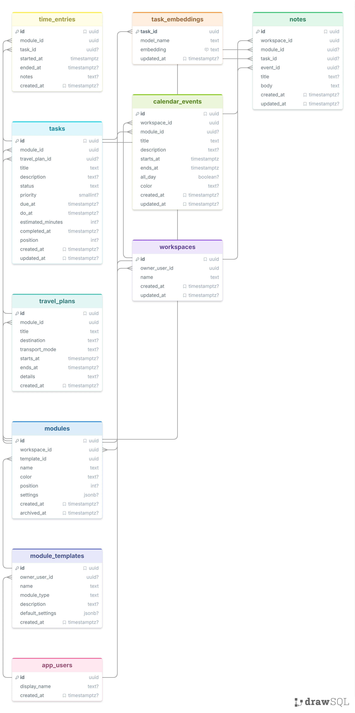
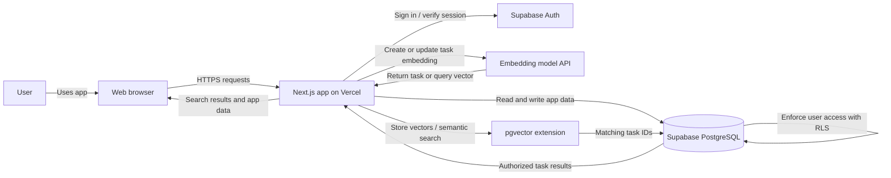
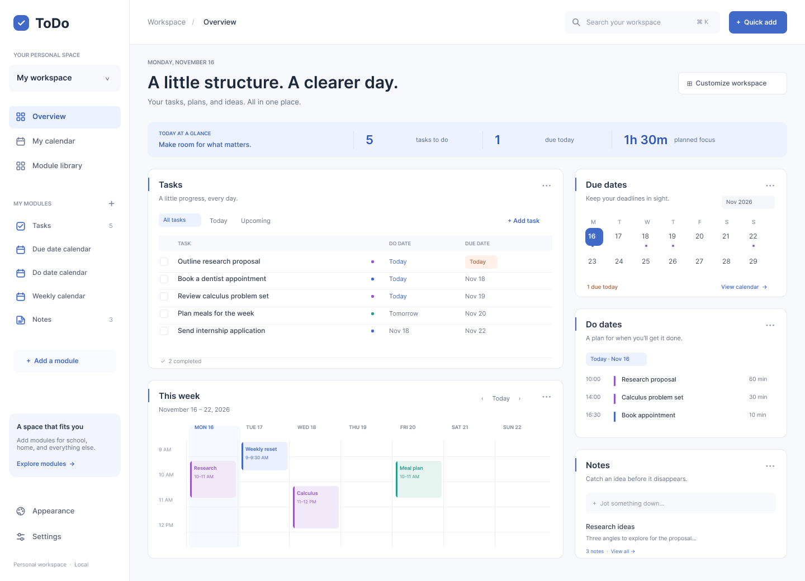
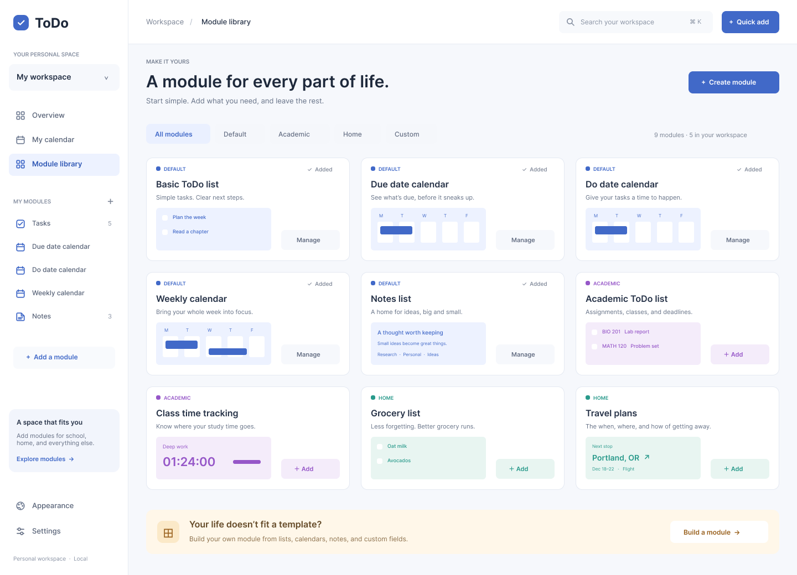
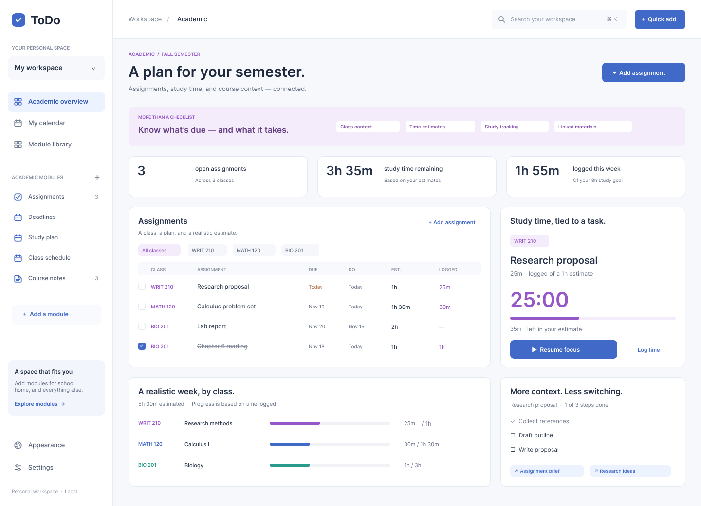
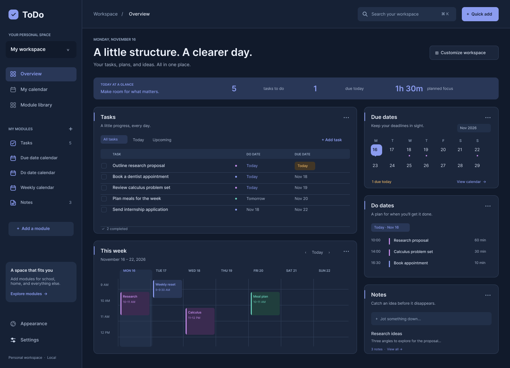
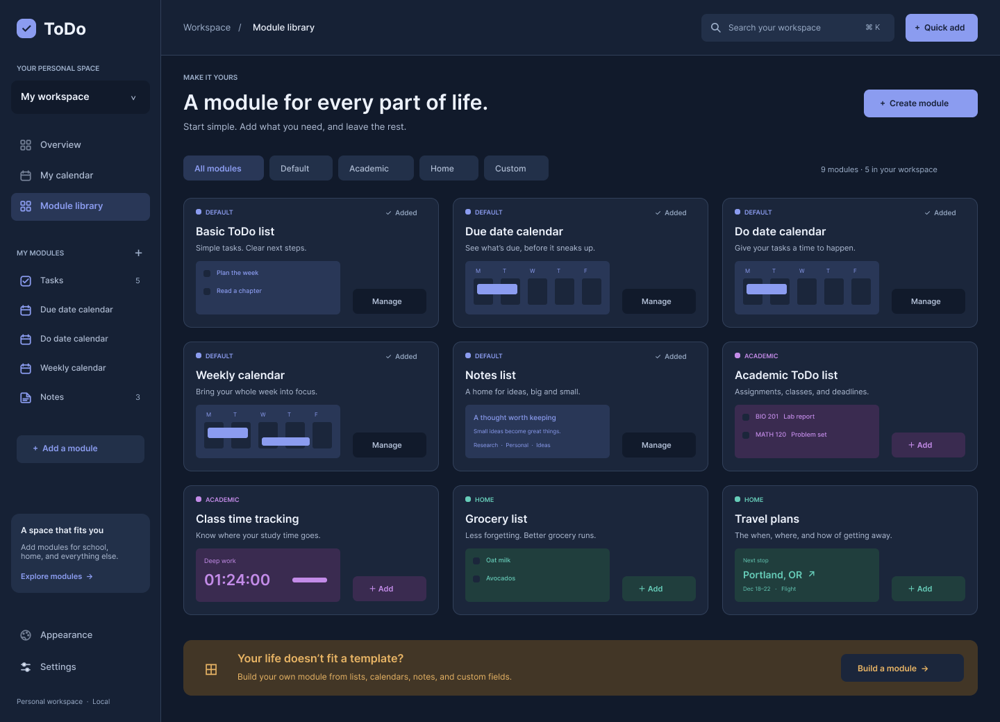
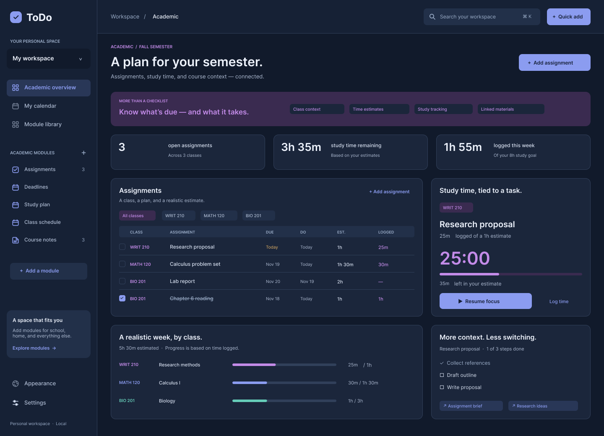

# Initial Project Design
## Summary of your project purpose and goals (words and pictures — help classmates quickly grasp your project)
When you open the app, you are presented with a default set of to-do modules, regular to-do lists, due date calendar, to do calendar, a weekly calendar, and notes. However, you can make your workspace your own. Add prebuilt modules from the academic or home module collections or build your own. Feel free to change the color scheme from light to dark, soft to vibrant, or whatever suites you. Don't remember what you planned to do today? Ask with the search bar that will perform a semantic search either workspace-wide or filtered to specific priorities, modules, or module collections. See what you need to do at a glance.

## Initial ERD sketching the data your project will use

## Rough system design diagram (technologies as shapes, interactions as arrows, can be a picture of a drawing on paper if you'd like)

## Initial daily goals from now through end of class
|Date|Goal|
|----|----|
|11/19|Initial Project Design |
|11/23|Start coding|
|11/28|Rough web app completed. Only final tweaks left.|
|12/5|Finished web app|

## Optional: rough UX sketches if applicable

